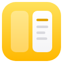

# NoteSidebar

Notas rápidas e minimalistas na barra lateral do Google Chrome, com visual inspirado no estilo Apple.



## Recursos

- Abre na **barra lateral** do Chrome (Side Panel), ao lado de qualquer site
- Design limpo, com **modo claro e escuro automáticos** (segue o sistema)
- Notas agrupadas por data: *Fixadas, Hoje, Ontem, Últimos 7 dias, Últimos 30 dias*, mês…
- **Busca** instantânea (ignora acentos: buscar "cafe" encontra "café")
- **Fixar** notas no topo
- **Salvamento automático** enquanto você digita
- Apagar com opção de **Desfazer**
- Sincroniza entre janelas abertas do Chrome
- Tudo fica salvo localmente no seu navegador (`chrome.storage.local`), sem servidor e sem rastreamento

## Instalação

1. Baixe este repositório (**Code → Download ZIP**) e descompacte, ou clone:
   ```bash
   git clone https://github.com/matheuslorransilv/notesidebar.git
   ```
2. Abra `chrome://extensions` no Chrome.
3. Ative o **Modo do desenvolvedor** (canto superior direito).
4. Clique em **Carregar sem compactação** e selecione a pasta `notesidebar`.
5. Fixe a extensão na barra (ícone de quebra-cabeça → alfinete) e clique no ícone para abrir as notas.

Requer Chrome 116 ou mais recente.

## Atalhos

| Atalho | Ação |
| --- | --- |
| `Alt + Shift + N` | Abrir a barra lateral (pode ser alterado em `chrome://extensions/shortcuts`) |
| `N` ou `Alt + N` | Nova nota |
| `/` | Buscar |
| `Enter` no título | Ir para o texto |
| `Esc` | Voltar para a lista |

## Estrutura

```
manifest.json    Configuração da extensão (Manifest V3)
background.js    Faz o clique no ícone abrir a barra lateral
sidepanel.html   Interface
sidepanel.css    Estilos (claro/escuro)
sidepanel.js     Lógica das notas e armazenamento
icons/           Ícones da extensão
```
